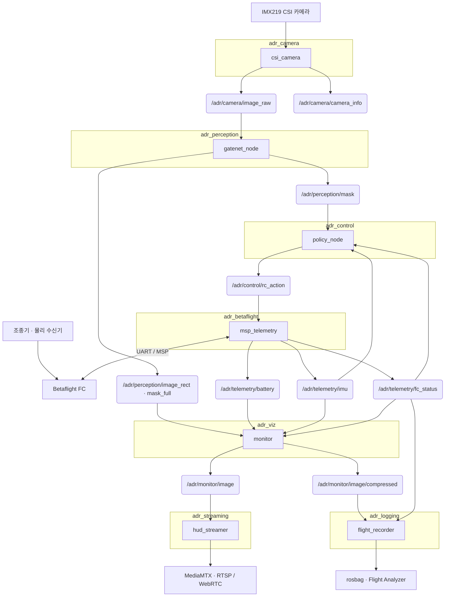
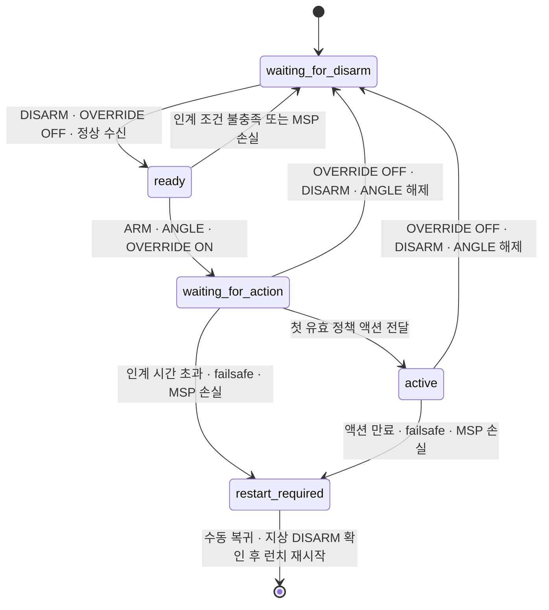

# Autonomous Drone Racing — ADR ROS 2

## 1. 시스템 개요

Jetson에서 CSI 카메라 영상으로 레이싱 게이트를 인식하고, GateNet 마스크와 Betaflight IMU로 비행 정책을 실행하는 ROS 2 시스템. 지상에서는 카메라·FC 텔레메트리·HUD 송출을 각각 점검할 수 있고, 실기체 및 스모크 실행은 rosbag으로 다시 볼 수 있다.

## 2. 요구사항

| 항목 | 기준 / 용도 |
| --- | --- |
| 컴패니언 컴퓨터 | NVIDIA Jetson, Ubuntu 22.04, JetPack 6 계열 |
| ROS | ROS 2 Humble, colcon |
| 카메라 | IMX219 CSI, NVIDIA Argus / GStreamer |
| GateNet | OpenCV, NumPy, PyYAML, TensorRT + PyCUDA 또는 ONNX Runtime |
| 비행 컨트롤러 | Betaflight, 조종기용 물리 수신기, Jetson UART용 MSP 포트 |
| UART | Python `pyserial`(`python3-serial`), 기본 500000 baud / 8N1 |
| 영상 송출 | PyGObject, GStreamer H.264 / RTSP 플러그인, 로컬 송출 시 MediaMTX |
| 녹화 | rosbag2 CLI, SQLite 저장 플러그인 |

카메라와 영상 의존성은 [CSI 카메라](src/adr_camera/README.md)와 [HUD 송출](src/adr_streaming/README.md)을 참고한다.

## 3. 노드 구조

큰 테두리는 ROS 패키지, 둥근 네모는 ROS 토픽이다. 아래는 실기체 프로필의 주요 데이터 흐름이다.



| 패키지 | 노드·실행 항목 | 역할 |
| --- | --- | --- |
| `adr_camera` | `csi_camera`, `image_relay` | CSI 영상과 보정 정보를 발행. `image_relay`는 별도 카메라 입력 연결에 사용 |
| `adr_perception` | `gatenet_node` | GateNet 추론, 정책용 마스크와 HUD용 보정 영상·마스크 발행 |
| `adr_betaflight` | `msp_telemetry` | MSP 조회, IMU·배터리·FC 상태·RC 발행, 인계 세션의 정책 RC 전달 |
| `adr_control` | `policy_node` | 100 Hz 정책 루프와 게이트 전환, 정규화 액션 발행 |
| `adr_viz` | `monitor` | 게이트 오버레이, FC 연결·자세·비행 상태·배터리 HUD |
| `adr_streaming` | `hud_streamer` | HUD를 H.264로 인코딩하고 RTSP 서버로 송출 |
| `adr_logging` | `flight_recorder` | 선택된 ROS 토픽을 rosbag으로 기록하고 세션 메타데이터 저장 |
| `adr_bringup` | 실기체·스모크·카메라 테스트 launch | 프로필을 읽고 노드, 송출, 녹화를 구성 |

## 4. 정책 인계 FSM



| 상태 | 동작 |
| --- | --- |
| `waiting_for_disarm` | DISARM, OVERRIDE OFF, failsafe 해제를 확인한다. |
| `ready` | 조종기가 제어한다. ARM·ANGLE에서 조종기가 OVERRIDE를 켜면 새 세션을 연다. |
| `waiting_for_action` | 정책이 G1부터 시작한다. 첫 유효 액션을 최대 250 ms 기다린다. |
| `active` | 현재 세션의 유효 액션을 FC로 전달한다. 액션 유효기간은 50 ms다. |
| `restart_required` | 정책 RC 송신을 중단한다. 조종기로 수동 복귀 후 지상에서 재시작한다. |

상태와 세션 ID는 `/adr/telemetry/fc_status`의 `rc_state`, `rc_session`에서 확인한다. HUD 테두리는 `DISARM` 회색, `ARM` 주황색, `AUTO` 초록색, `NO STATUS` 빨간색이다. 정책 RC 사용 중에는 `active`일 때 `AUTO`이며, 텔레메트리 모드에서는 ARM과 MSP OVERRIDE가 함께 활성일 때 `AUTO`로 표시한다. MSP가 끊기거나 FC 상태가 0.5초 이상 갱신되지 않으면 `NO STATUS`를 표시한다.

Betaflight 4.4.3에서는 입력이나 UART가 끊기면 FC가 기존 MSP 스틱값을 유지할 수 있다. OVERRIDE를 OFF로 돌려 수동 복귀한다. MSP RC 입력 만료를 지원하는 펌웨어는 링크 손실 시 마지막 프레임이 만료되면 수신기로 복귀한다. 첫 인계와 수동 복귀 확인은 프롭을 제거한 벤치에서 진행한다. [4.4.3 OVERRIDE 처리](https://github.com/betaflight/betaflight/blob/4.4.3/src/main/rx/msp_override.c#L27-L38) · [Betaflight MSP OVERRIDE 안내](https://betaflight.com/docs/wiki/guides/current/MSP-Companion-Computer-Control)

### HUD 제어 상태 4줄

우상단 FC 연결·자세 표시 아래에 RC 상태, 정책 상태, 마스크 나이, IMU 나이가 차례로 표시된다. 정책 상태를 한 번 이상 받은 뒤 이 영역이 나타난다.

**첫째 줄 · RC 인계 상태**는 `/adr/telemetry/fc_status`의 `rc_state`를 사용한다.

| HUD | 상태 값 | 색상 | 의미 |
| --- | --- | --- | --- |
| `RC ACTIVE` | `active` | 초록 | 유효한 정책 액션을 받아 FC로 RC 명령을 보내는 중이다. |
| `RC READY` | `ready` | 주황 | 수동 제어 상태에서 인계 가능 조건을 충족했다. ARM 상태에서 ANGLE이 켜져 있고 OVERRIDE를 올리면 인계를 시작한다. |
| `RC WAIT ACTION` | `waiting_for_action` | 주황 | 인계 세션을 열었고 첫 유효 정책 액션을 최대 250 ms 기다린다. |
| `RC WAIT DISARM` | `waiting_for_disarm` | 주황 | DISARM, OVERRIDE OFF, failsafe 해제를 함께 기다린다. 이미 디스암이어도 AUX4에 설정한 OVERRIDE가 켜져 있으면 이 상태에 머무른다. |
| `RESTART REQUIRED` | `restart_required` | 빨강 | 첫 액션 대기 초과, 정책 액션 만료, 인계 중 failsafe나 링크 손실 등으로 정책 RC 송신이 중단됐다. 수동 복귀 후 지상에서 런치를 재시작해야 새 인계를 할 수 있다. |
| `RC OFF` | `disabled` | 회색 | 정책 RC 송신이 비활성화됐다. 정책 번들을 별도로 실행했다면 ROS 액션은 확인할 수 있다. |
| `RC UNAVAILABLE` | `unavailable` | 회색 | FC에는 연결됐지만 정책 RC 사용 조건을 충족하지 못했다. MSP 노드의 설정 확인 로그를 본다. |
| `RC NO STATUS` | 표시 가능한 상태 없음 | 회색 | FC 연결이 없거나 FC 상태가 오래됐거나 상태 값을 해석할 수 없다. |

**둘째 줄 · 정책 상태**는 `/adr/control/status`의 `state`를 사용한다.

| HUD | 상태 값 | 색상 | 의미 |
| --- | --- | --- | --- |
| `POLICY <값> Hz` | `running` | 흰색 | 정책이 유효한 액션을 발행 중이다. Hz는 최근 보고 구간에서 완료한 스텝의 실측 빈도다. |
| `WAITING FOR OVERRIDE` | `waiting_for_override` | 주황 | 정책 RC 인계 세션을 기다린다. |
| `WAITING FOR INPUTS` | `waiting_for_inputs` | 주황 | 새 인계 세션으로 전환한 뒤 필요한 입력을 확인 중이다. |
| `WAITING FOR MASK` | `waiting_for_mask` | 주황 | 사용할 마스크를 아직 받지 못했다. |
| `WAITING FOR IMU` | `waiting_for_imu` | 주황 | 사용할 실측 IMU를 아직 받지 못했다. |
| `MASK STALE` | `stale_mask`, `stopped_stale_mask` | 빨강 | 마스크 유효기간을 넘겨 액션을 발행하지 않았다. |
| `IMU STALE` | `stale_imu`, `stopped_stale_imu` | 빨강 | IMU 유효기간을 넘겨 액션을 발행하지 않았다. |
| `STALE FC STATUS`, `STOPPED STALE FC STATUS` | `stale_fc_status`, `stopped_stale_fc_status` | 빨강 | 인계 중 FC 상태 갱신이 끊겼다. |
| `POLICY NO STATUS` | 최근 정책 상태 없음 | 회색 | 이전에 받던 정책 상태가 모니터의 만료 시간 안에 갱신되지 않았다. |

`stale_*` 상태에서는 새 입력을 기다린다. 실측 IMU로 이미 실행 중이던 정책이 입력 만료로 멈추면 `stopped_*` 상태가 유지되며, 새 입력이 들어와도 추론을 재개하려면 정책 노드를 재시작해야 한다. HUD는 마스크·IMU의 두 상태를 같은 문구로 줄여 표시하므로, 구분하려면 `/adr/control/status`의 원본 상태를 확인한다.

**셋째·넷째 줄 · 입력 나이**는 `MASK <값> ms`와 `IMU <값> ms`로 항상 흰색이다. 정책이 마지막으로 보고한 입력 나이이며, 값이 없으면 `-- ms`로 표시한다. 입력을 계속 받으면 나이는 다시 낮아질 수 있고, 이미 멈춘 정책의 정지 문구는 계속 표시된다.

## 5. 관측과 제어

### 5.1 카메라와 GateNet

- IMX219 mode 3에서 **1640×1232, 30 fps**로 캡처하고, 카메라 노드에서 **320×240 BGR**로 하드웨어 축소한다.
- GateNet은 정책용 **64×64 `mono8`** 마스크와 HUD용 **320×240** 보정 영상·마스크를 발행한다. 마스크 픽셀은 0 또는 255다.
- GateNet 출력은 카메라 타임스탬프를 보존한다. HUD는 타임스탬프가 일치하는 보정 영상과 마스크를 합성한다.
- 실기체·스모크 런치는 기본으로 Argus 자동 노출과 게인을 사용한다. `auto_exposure:=false`는 YAML을 적용한다. 기본 고정 설정은 8.33 ms, 아날로그·ISP 게인 1이다. 카메라 테스트는 YAML 설정을 사용한다.

### 5.2 Betaflight 텔레메트리와 HUD

- IMU와 자세 조회는 MSP로 묶어 **100 Hz**를 목표로 한다. 같은 조회에 조종 채널 **25 Hz**, 배터리 **2 Hz**를 추가한다. `betaflight.rc_hz: 0.0`은 RC 조회를 끈다.
- IMU 자세는 ENU 월드 기준의 FLU 쿼터니언, 각속도는 rad/s, 가속도는 기체 FLU 기준 m/s²다. 기본 가속도 스케일은 **512 LSB/g**다. 수평 정지에서 첫 raw 샘플의 Z가 약 +512 LSB, 발행된 IMU의 Z가 약 +9.81 m/s²인지 확인한다.
- IMU 타임스탬프는 Jetson의 응답 수신 시각이다. yaw는 FC 헤딩을 기준으로 한다.
- HUD 우상단에 MSP 연결과 롤·피치·요, 좌상단에 비행 상태, 하단에 배터리 전압과 추정 잔량을 표시한다. 잔량은 FC 전류계와 용량 설정으로 추정하고, 해당 정보가 없으면 FC의 셀 전압 범위를 사용한다.
- HUD의 기본 배터리 입력은 ROS `sensor_msgs/BatteryState`다. PX4 DDS를 쓰는 구성은 `px4_msgs`를 준비하고 `viz.battery_source: px4`를 지정한다.

### 5.3 100 Hz 정책

- GateNet과 `b6p53M` 정책의 기본 백엔드는 TensorRT다. 기본 정책 엔진은 번들과 함께 설치되고, `policy_backend:=torch`로 PyTorch를 선택할 수 있다.
- 엔진과 모델 파일은 Git LFS로 관리한다. 빌드 전 이 저장소에서 `git lfs install`과 `git lfs pull`을 실행한다.
- 다른 Jetson 환경에서 정책 엔진을 다시 빌드할 때는 아래 명령을 쓴다. 내보내기에는 PyTorch와 ONNX가 필요하며, 엔진 실행에는 TensorRT와 PyCUDA가 필요하다.

```bash
source /opt/ros/humble/setup.bash
source install/setup.bash
engine_dir="$PWD/.deps/policy-trt/b6p53M"
python3 scripts/export_policy_trt.py src/adr_control/policies/b6p53M "$engine_dir"
for name in encoder step; do
  /usr/src/tensorrt/bin/trtexec --onnx="$engine_dir/$name.onnx" \
    --saveEngine="$engine_dir/$name.plan" --noTF32 --skipInference || break
done
ros2 launch adr_bringup real.launch.py policy_bundle:=b6p53M \
  policy_engine_dir:="$engine_dir" policy_rc:=false
```

- 관측의 기본 유효기간은 마스크 **150 ms**, IMU **50 ms**다. IMU 유효기간은 [real.yaml](src/adr_bringup/config/real.yaml)의 `policy.imu_timeout_s`에 초 단위로 지정한다. 입력이 만료되면 정책 액션 발행을 멈춘다. 실측 IMU로 추론하던 중 입력이 만료되면 노드를 재시작한다.
- 출력은 `throttle, roll, pitch, yaw rate` 순서의 정규화 액션 네 개다. `policy_rc:=true`에서 인계가 성립하면 세션 ID와 단조 시계 타임스탬프가 붙은 액션을 Betaflight 브리지로 보낸다.

### 5.4 주요 토픽

| 토픽 | 내용 |
| --- | --- |
| `/adr/camera/image_raw`, `/adr/camera/camera_info` | 320×240 카메라 영상과 보정값 |
| `/adr/perception/mask`, `/adr/perception/latency_ms` | 정책용 마스크와 카메라 타임스탬프부터 발행 직전까지의 지연 |
| `/adr/perception/image_rect`, `/adr/perception/mask_full` | HUD용 보정 영상과 전체 해상도 마스크 |
| `/adr/telemetry/imu`, `/adr/telemetry/battery` | IMU·자세와 배터리 전압·전류·잔량 |
| `/adr/telemetry/fc_status` | 연결, FC 버전, ARM, ANGLE, MSP OVERRIDE, failsafe, 수신기 손실, ARM 차단 사유, 정책 RC 상태·세션 |
| `/adr/telemetry/rc` | FC 적용 스틱 값과 `aux_us`(AUX1부터), ARM·OVERRIDE·failsafe 상태 |
| `/adr/control/action`, `/adr/control/rc_action` | 정규화 정책 액션과 인계 세션의 RC 액션 |
| `/adr/control/status` | 추론 빈도, 10 ms 초과 횟수, 입력 나이, 게이트 인덱스, `p_g` |
| `/adr/monitor/image`, `/adr/monitor/image/compressed`, `/adr/monitor/status` | 원본 HUD, JPEG HUD, 배터리·비행 표시 상태 |

`fc_status.arming_disable_flags`는 활성 차단 사유의 배열이다. `[]`는 활성 사유 없음, `null`은 확인 가능한 상태 응답 없음, `BIT_n`은 이름을 매핑하지 못한 비트를 뜻한다. `arming_disable_mask`에는 원본 비트마스크를 담는다. `/adr/telemetry/rc`는 FC가 적용 중인 채널을 조회하므로 OVERRIDE나 failsafe 중에는 해당 모드의 값이 포함될 수 있다.

## 6. 실행방법

### 6.1 Jetson 준비와 빌드

저장소 루트에서 실행한다. TensorRT를 쓰는 경우 Jetson에서 엔진을 생성한 뒤 빌드한다. 외부 엔진은 `real.yaml`의 `perception.engine_file`에 절대 경로로 지정할 수 있다.

```bash
/usr/src/tensorrt/bin/trtexec --onnx=src/adr_perception/configs/gatenet_240x320.onnx \
  --saveEngine=src/adr_perception/configs/gatenet_240x320_fp16.plan --fp16
```

```bash
source /opt/ros/humble/setup.bash
colcon build --symlink-install
source install/setup.bash
export ADR_ROOT="$PWD"
```

새 터미널에서도 ROS와 워크스페이스를 소싱한다. MediaMTX는 `PATH` 또는 `$ADR_ROOT/.deps/hud/mediamtx`에서 찾는다. `ros2 topic` 조회에는 런치와 같은 `ROS_DOMAIN_ID`를 사용한다. 기본 도메인은 `0`이다.

저장소의 `.deps/smoke`에 GStreamer 플러그인이 있고 `~/gatenet_ws/.venv`에 PyCUDA를 설치한 Jetson에서는 아래 환경도 적용한다.

```bash
gst_lib="$ADR_ROOT/.deps/smoke/gst/usr/lib/aarch64-linux-gnu"
export LD_LIBRARY_PATH="$gst_lib${LD_LIBRARY_PATH:+:$LD_LIBRARY_PATH}"
export GST_PLUGIN_PATH="$gst_lib/gstreamer-1.0${GST_PLUGIN_PATH:+:$GST_PLUGIN_PATH}"
export PYTHONPATH="$HOME/gatenet_ws/.venv/lib/python3.10/site-packages${PYTHONPATH:+:$PYTHONPATH}"
```

### 6.2 카메라·FC 스모크 테스트

| 런치 | 실행 구성 |
| --- | --- |
| `camera_test.launch.py` | CSI 카메라, GateNet, HUD. `view:=true`(기본값)로 로컬 rqt 이미지 뷰어 실행 |
| `smoke_test.launch.py` | 카메라, GateNet, HUD, 실시간 송출, rosbag |
| `fc_smoke_test.launch.py` | 영상 스모크 구성에 Betaflight 읽기 전용 텔레메트리 추가 |

아래 명령은 한 번에 하나씩 실행한다. FC 스모크는 예시의 포트와 baud를 실제 기체에 맞춘다.

```bash
ros2 launch adr_bringup camera_test.launch.py view:=false
ros2 launch adr_bringup smoke_test.launch.py
ros2 launch adr_bringup fc_smoke_test.launch.py msp_port:=/dev/ttyTHS1 msp_baud:=500000
```

지상국에서 `rtsp://JETSON_IP:8554/hud`를 열면 HUD를 볼 수 있다. MediaMTX의 WebRTC가 켜져 있으면 `http://JETSON_IP:8889/hud`도 사용할 수 있다. 저지연 GStreamer 재생은 [HUD 송출 안내](src/adr_streaming/README.md)를 참고한다.

### 6.3 실기체 런치

기본 설정은 [real.yaml](src/adr_bringup/config/real.yaml)에 있다. FC에서는 Jetson이 연결된 UART의 `Configuration/MSP`만 켜고 baud를 Jetson 설정과 맞춘다. 기본값은 `/dev/ttyTHS1`과 `500000`이다. UART 전압 레벨을 확인하고 TX–RX를 교차 연결하며 GND를 공유한다. [Betaflight Ports 설정](https://betaflight.com/docs/wiki/app/ports-tab)

```bash
# 영상과 FC 텔레메트리만 점검
ros2 launch adr_bringup real.launch.py policy_rc:=false

# 기본 실기체 구성
ros2 launch adr_bringup real.launch.py
```

정책 RC 사용 시 물리 수신기, AETR 채널 맵, ANGLE·MSP OVERRIDE 모드를 사용한다. FC에서 ARM과 MSP OVERRIDE는 물리 조종기 스위치에 매핑한다. 기존 정책 프로필의 FC 설정은 `msp_override_channels_mask = 15`, `angle_limit = 55`, yaw 최대 스틱 각속도 약 229°/s를 기준으로 한다. 지원되는 펌웨어에서는 `msp_override_failsafe`를 OFF로 사용한다. `serial_update_rate_hz`와 실제 IMU 발행률은 [MSP 계측](scripts/msp_diagnostics/README.md)으로 확인한다.

| 인자 | 기본값 | 용도 |
| --- | --- | --- |
| `config` | 설치된 `config/real.yaml` | 기체별 YAML 경로 |
| `auto_exposure` | `true` | Argus 자동 노출·게인 |
| `msp` | `true` | Betaflight 브리지 실행 |
| `msp_port`, `msp_baud` | YAML 값 | 시리얼 장치와 baud 덮어쓰기 |
| `policy_rc` | MSP 사용 및 실측 IMU 모드에서 `true` | 정책 RC 경로 활성화 |
| `policy_bundle` | 정책 RC·벤치 IMU 실행 시 `b6p53M` | 내장 번들 또는 외부 번들의 절대 경로 |
| `policy_bench_imu` | `false` | 정지·수평 IMU를 넣어 추론 점검 |
| `stream_url` | `local` | 로컬 MediaMTX, 외부 RTSP 송출 주소, 또는 빈 값으로 송출 끄기 |
| `record`, `log_dir` | `true`, `flight_logs/` | 기록 여부와 로그 루트 |
| `record_trigger` | `launch` | 실기체 런치에서 `px4_arm` 선택 가능 |

실측 IMU로 **추론만** 보려면 `policy_bundle:=b6p53M policy_rc:=false`를 사용한다. 벤치 IMU로 테스트하려면 `policy_bench_imu:=true`를 사용한다. 별도 터미널에서 다음 중 필요한 항목을 확인한다.

```bash
ros2 topic hz /adr/telemetry/imu
ros2 topic echo /adr/telemetry/fc_status --field data --qos-reliability best_effort
ros2 topic echo /adr/telemetry/rc --field data --qos-reliability best_effort
ros2 topic echo /adr/control/status --qos-reliability best_effort
```

MSP만 단독 확인하려면 아래를 실행한다. 같은 시리얼 장치를 쓰는 런치는 먼저 종료한다.

```bash
ros2 run adr_betaflight msp_telemetry --ros-args \
  -p port:=/dev/ttyTHS1 -p baud:=500000 -p acc_lsb_per_g:=512.0
```

### 6.4 비행 로그 녹화 및 재생

실기체와 두 스모크 런치는 기본으로 시작부터 종료까지 `flight_logs/<세션>/bag/`에 기록한다. `Ctrl+C`로 종료하면 bag이 마감된다. 세션의 `manifest.json`에 런치 프로필과 시작 시각을 저장하며, Flight Analyzer 목록에서 **REAL**과 **SMOKE** 태그를 표시한다. GateNet 입력 JPEG·마스크 PNG·CSV를 별도로 저장하려면 실기체 YAML에서 `perception.record: true`를 지정한다.

뷰어 설치·재생과 기록 항목은 [Flight Analyzer](scripts/flight_analyzer/README.md)를 참고한다. UART 응답 지연이나 재연결 원인은 [MSP 계측](scripts/msp_diagnostics/README.md)의 단독 프로브와 실제 런치 계측으로 확인할 수 있다. 정밀착륙에서 가져온 ArUco·SITL·HITL 코드는 [legacy/precision_landing](legacy/precision_landing/)에 보관한다.
